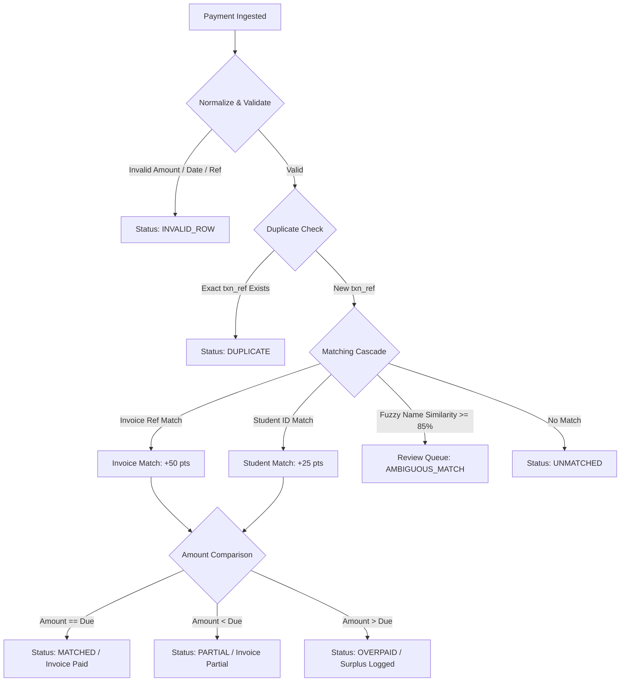

# FeeReconcile (feeSync)

[](https://fastapi.tiangolo.com)
[](https://www.python.org/)
[](https://sqlite.org/)
[](https://github.com/rapidfuzz/RapidFuzz)
[](https://developer.mozilla.org/)
[-4caf50.svg)](#running-tests)

**FeeReconcile** is an automated, production-grade financial reconciliation and student ledger engine engineered specifically for educational institutions (universities, colleges, and schools).

It ingests unstandardized payment feeds—originating from bank statements, UPI gateways, NEFT/RTGS transaction dumps, cheques, demand drafts, and cash counter logs—and automatically reconciles them against student fee obligations in accordance with strict institutional accounting rules, zero-rounding-error integer currency arithmetic, and transparent audit logging.

---

## Table of Contents
- [1. Overview & Problem Statement](#1-overview--problem-statement)
- [2. Key Features](#2-key-features)
- [3. Architecture & Tech Stack](#3-architecture--tech-stack)
- [4. Project Structure](#4-project-structure)
- [5. Installation & Setup Instructions](#5-installation--setup-instructions)
- [6. Running the Application](#6-running-the-application)
- [7. Running the Test Suite](#7-running-the-test-suite)
- [8. Step-by-Step Interactive Demo Walkthrough](#8-step-by-step-interactive-demo-walkthrough)
- [9. Reconciliation Engine Pipeline](#9-reconciliation-engine-pipeline)
- [10. CSV Specification & File Formats](#10-csv-specification--file-formats)
- [11. REST API Reference](#11-rest-api-reference)
- [12. Verification & Accounting Invariants](#12-verification--accounting-invariants)

---

## 1. Overview & Problem Statement

### The Problem
Indian educational institutions collect millions of rupees each semester through fragmented payment channels:
- Payer remarks often contain student name typos (e.g., `"Saravnan"` instead of `"Saravanan Natarajan"`).
- Students quote invalid roll numbers or forget invoice IDs entirely.
- Parents frequently make partial payments or accidentally submit payments twice.
- Bulk bank dumps arrive with messy transaction formatting (`Rs. 50000`, `₹50,000.00`, missing commas).
- Floating-point calculations in conventional software lead to fractional rounding errors across thousands of transactions.

### The Solution
**FeeReconcile** eliminates manual spreadsheet reconciliations by providing:
1. **Integer Paise Precision**: All currency is stored and computed strictly as integer paise (1 Rupee = 100 paise). Floating-point drift is mathematically impossible.
2. **4-Stage Matching Cascade**: Sequentially attempts Exact Invoice Matching $\to$ Student ID Oldest-Invoice Waterfall $\to$ RapidFuzz Fuzzy Name Transliteration $\to$ Unmatched Fallback.
3. **Automated Confidence Scoring (0–100)**: Transparent score breakdown based on exact invoice references, student ID verification, balance alignment, and token-set name similarity.
4. **Interactive Exception Resolution Queue**: Ambiguous names, duplicates, and unmatched payments are surfaced with one-click manual assignment and full audit trails.
5. **Zero-Dependency Modern Frontend**: Clean, responsive, dark/light theme dashboard built in pure HTML5, CSS3, and modern vanilla JavaScript—no node modules, no bundlers, instant loading.

---

## 2. Key Features

- **Dynamic Financial Dashboard**:
  - Real-time KPI summaries: **Total Due**, **Total Collected**, **Outstanding Balance**, and **Collection Rate %**.
  - Interactive **Payments by Match Status** progress bar cards (Exact Matched, Partial, Review Queue, Duplicates, Unmatched, Overpaid, Invalid).
  - Indian currency typography formatted with proper commas (`₹1,25,000.00`), zero-balance indicators (`—`), and `tabular-nums` alignment.
- **Robust Exception Handling**:
  - `AMBIGUOUS_MATCH`: Fuzzy name matches (>= 85%) are safely held in the Review Queue; administrators can match them to the correct student with an audit note.
  - `DUPLICATE`: Re-uploaded transactions and duplicate bank reference IDs (`txn_ref`) are rejected without double-counting balances.
  - `PARTIAL`: Allocates received funds to tuition heads and tracks outstanding dues.
  - `OVERPAID`: Tracks surplus collections for refund voucher generation or advance semester credits.
  - `INVALID_ROW`: Flags malformed rows without crashing the batch ingestion pipeline.
- **Idempotency Guarantee**:
  - Re-uploading the exact same CSV multiple times produces identical balances and marks redundant rows as duplicates.
- **Audit Ledger & CSV Export**:
  - Complete payment allocation histories, fee head breakdowns, and instant reconciliation ledger CSV export.
- **Demo & Presentation Mode**:
  - One-click **"Clear Data"** button with a safety modal to wipe recorded data for fresh demonstrations.
  - One-click **"Load Demo Data"** to populate realistic sample batches instantly.

---

## 3. Architecture & Tech Stack

| Layer | Technology | Description |
|---|---|---|
| **Backend Framework** | **FastAPI** (Python 3.10+) | High-performance asynchronous REST API with automatic OpenAPI (Swagger) generation. |
| **Data Validation** | **Pydantic v2** | Strict schema validation, sanitization, and serialization. |
| **Database & ORM** | **SQLAlchemy 2.0** + **SQLite** | Relational data persistence with WAL (Write-Ahead Logging) mode and transactional isolation. |
| **Financial Arithmetic** | **Integer Paise Math** | 64-bit integer paise storage for zero rounding discrepancies (`amount_paise = int(round(amount * 100))`). |
| **Fuzzy Matching** | **RapidFuzz 3.x** | High-performance C++ backed token-set and Levenshtein similarity scoring for Indian name spelling variations. |
| **Frontend UI** | **Vanilla HTML5, CSS3, ES6+ JS** | Zero-dependency SPA with custom CSS design tokens, light/dark themes, responsive grid/flexbox, and SVG icons. |
| **Testing** | **Pytest 8.x** | 16 comprehensive integration and unit tests validating 100% of reconciliation scenarios. |

---

## 4. Project Structure

```text
feeSync/
├── app/
│   ├── main.py                     # FastAPI application setup, static files mount & lifespan
│   ├── database.py                 # SQLite engine, sessionmaker & Base definition
│   ├── models.py                   # SQLAlchemy ORM models (Students, Invoices, Payments, etc.)
│   ├── schemas.py                  # Pydantic v2 request/response schemas
│   ├── routers/
│   │   ├── students.py             # Student registration & CSV bulk import endpoints
│   │   ├── invoices.py             # Fee invoice creation & CSV bulk import endpoints
│   │   ├── payments.py             # Payment ingestion, manual logging & exception resolution
│   │   ├── reports.py              # Financial KPI summaries & CSV ledger export
│   │   └── demo.py                 # Demo data loader and database reset endpoints
│   ├── services/
│   │   ├── normalizer.py           # String trimming, date parsing, paise currency conversion
│   │   ├── matcher.py              # 4-stage matching cascade & RapidFuzz scoring
│   │   ├── reconciler.py           # Multi-invoice payment allocation & invoice status transitions
│   │   ├── scoring.py              # 0-100 confidence scoring engine
│   │   └── report.py               # Aggregations, ledger generation & CSV formatting
│   └── static/
│       ├── index.html              # Single-page dashboard interface
│       ├── css/
│       │   └── styles.css          # Fintech design system, theme variables, and tables
│       └── js/
│           └── app.js               # Reactive vanilla JavaScript application logic
├── demo_files/                     # Sequentially numbered CSV files for live demonstrations
│   ├── 01_STEP1_upload_to_students.csv
│   ├── 02_STEP2_upload_to_invoices.csv
│   ├── 03_STEP3_payment_exact_match.csv
│   ├── 04_STEP4_payment_partial.csv
│   ├── 05_STEP5_payment_ambiguous_fuzzy_name.csv
│   ├── 06_STEP6_payment_duplicate_txn.csv
│   ├── 07_STEP7_payment_overpaid_excess.csv
│   ├── 08_STEP8_payment_unmatched_student.csv
│   ├── 09_STEP9_payment_invalid_row.csv
│   ├── 10_ALL_IN_ONE_master_demo_batch.csv
│   └── DEMO_INSTRUCTIONS.md        # Step-by-step presentation script
├── sample_data/                    # Baseline sample data files
│   ├── students.csv
│   ├── invoices.csv
│   └── payments_demo.csv
├── tests/
│   └── test_reconciler.py          # Pytest suite with 16 comprehensive test cases
├── requirements.txt                # Python dependencies
├── .gitignore                      # Git ignore rules for virtual environments & SQLite WAL files
└── README.md                       # Comprehensive documentation
```

---

## 5. Installation & Setup Instructions

### Prerequisites
- **Python 3.10, 3.11, 3.12, or 3.14** installed on your system.
- **Git** installed.

### Step 1: Clone the Repository
```bash
git clone https://github.com/Saravanan-space/feesync.git
cd feesync
```

### Step 2: Create and Activate a Virtual Environment
- **Windows (PowerShell)**:
  ```powershell
  python -m venv venv
  .\venv\Scripts\Activate.ps1
  ```
- **macOS / Linux**:
  ```bash
  python3 -m venv venv
  source venv/bin/activate
  ```

### Step 3: Install Required Dependencies
```bash
pip install -r requirements.txt
```

---

## 6. Running the Application

### Start the Development Server
```bash
uvicorn app.main:app --reload
```

The server will initialize SQLite database tables automatically on startup and begin serving on port `8000`.

### Access the Web Application
Open your web browser and navigate to:
- **Web Dashboard**: [http://127.0.0.1:8000](http://127.0.0.1:8000)
- **Interactive OpenAPI / Swagger Documentation**: [http://127.0.0.1:8000/docs](http://127.0.0.1:8000/docs)
- **Alternative ReDoc API Documentation**: [http://127.0.0.1:8000/redoc](http://127.0.0.1:8000/redoc)

---

## 7. Running the Test Suite

FeeReconcile includes a test suite covering invoice status derivations, exact matching, waterfall allocations, fuzzy matching thresholds, idempotency, duplicate detection, and overpayment handling.

Run the test suite with verbose output:
```bash
pytest tests/test_reconciler.py -v
```

Expected output:
```text
tests/test_reconciler.py::test_invoice_status_derivation PASSED          [  6%]
tests/test_reconciler.py::test_exact_match PASSED                        [ 12%]
tests/test_reconciler.py::test_student_only_match PASSED                 [ 18%]
tests/test_reconciler.py::test_exact_duplicate PASSED                    [ 25%]
tests/test_reconciler.py::test_suspected_duplicate PASSED                [ 31%]
tests/test_reconciler.py::test_partial_payment PASSED                    [ 37%]
tests/test_reconciler.py::test_overpaid PASSED                           [ 43%]
tests/test_reconciler.py::test_unmatched PASSED                          [ 50%]
tests/test_reconciler.py::test_fuzzy_name_review PASSED                  [ 56%]
tests/test_reconciler.py::test_invalid_row PASSED                        [ 62%]
tests/test_reconciler.py::test_multi_invoice_allocation PASSED           [ 68%]
tests/test_reconciler.py::test_idempotent_reimport PASSED                [ 75%]
tests/test_reconciler.py::test_step5_confidence_scoring_rules PASSED     [ 81%]
tests/test_reconciler.py::test_itemized_fee_head_priority_allocation PASSED [ 87%]
tests/test_reconciler.py::test_overpayment_refund_voucher_action PASSED  [ 93%]
tests/test_reconciler.py::test_overpayment_roll_advance_credit_action PASSED [100%]

============================= 16 passed in ~1s ==============================
```

---

## 8. Step-by-Step Interactive Demo Walkthrough

The `demo_files/` directory contains sequentially named CSV files specifically structured to demonstrate each scenario step-by-step:

### Preparation: Clean Slate
1. Open [http://127.0.0.1:8000](http://127.0.0.1:8000).
2. Click the **"Clear data"** button in the top navigation bar.
3. Confirm in the modal dialog. The application will wipe the database and show ₹0.00 across all dashboard cards.

---

### Step 1: Upload Students Registry
- **File**: `demo_files/01_STEP1_upload_to_students.csv`
- **Location in App**: **Fee Obligations** tab $\to$ click **"Upload students CSV"**.
- **What happens**: Registers 8 students (`1KS25AI101` to `1KS25AI108`) with Indian names, emails, and phone numbers.

### Step 2: Upload Fee Invoices
- **File**: `demo_files/02_STEP2_upload_to_invoices.csv`
- **Location in App**: **Fee Obligations** tab $\to$ click **"Upload invoices CSV"**.
- **What happens**:
  - Creates invoices `INV-001` through `INV-008` totaling **₹4,75,000.00**.
  - Dashboard updates to **₹4,75,000.00 Due**, **₹4,75,000.00 Outstanding**, **0.00% Collected**.
  - `INV-008` immediately displays in red as **Overdue** because its due date is in the past.

### Step 3: Exact Match (Case 1)
- **File**: `demo_files/03_STEP3_payment_exact_match.csv`
- **Location in App**: **Payments** tab $\to$ click **"Upload payments CSV"**.
- **Result**:
  - `TXN2026100101` pays ₹50,000 against `INV-001` (`Aarav Sharma`).
  - Score: **100/100** (`Auto-reconciled`). Status: **`Matched`**.
  - `INV-001` status changes from `Pending` to **`Paid`** (green).

### Step 4: Partial Payment (Case 2)
- **File**: `demo_files/04_STEP4_payment_partial.csv`
- **Result**:
  - `TXN2026100404` pays ₹25,000 against `INV-004` (Amount due: ₹50,000).
  - Status: **`Partial`**. `INV-004` updates to **Partial** with ₹25,000 paid and ₹25,000 outstanding.
  - A `PARTIAL` exception note is logged with remaining balance details.

### Step 5: Ambiguous Fuzzy Name Match (Case 3)
- **File**: `demo_files/05_STEP5_payment_ambiguous_fuzzy_name.csv`
- **Result**:
  - `TXN2026100606` has no invoice reference, but payer name contains typo `"Saravnan"` (vs `"Saravanan Natarajan"`).
  - Score: **70/100**. Status: **`Review`**.
  - Held in **Exceptions** queue under `AMBIGUOUS_MATCH` (94% similarity).
  - **Resolution**: Click **"Assign"** $\to$ select `1KS25AI106` $\to$ confirm. The ₹50,000 is immediately reconciled to `INV-006`!

### Step 6: Duplicate Transaction Detection (Case 4)
- **File**: `demo_files/06_STEP6_payment_duplicate_txn.csv`
- **Result**:
  - Re-submits `TXN2026100101` (already processed in Step 3).
  - Status: **`Duplicate`**. Flagged with a `DUPLICATE` exception referencing original payment ID.
  - No money is applied; invoice balances and dashboard collection numbers remain unaffected.

### Step 7: Overpaid Transaction (Case 5)
- **File**: `demo_files/07_STEP7_payment_overpaid_excess.csv`
- **Result**:
  - `TXN2026100707` pays ₹55,000 for invoice `INV-007` (due: ₹50,000).
  - Status: **`Overpaid`**. `INV-007` is marked **Paid**; surplus of ₹5,000 is logged in `OVERPAID` exception.

### Step 8: Unmatched Student (Case 6)
- **File**: `demo_files/08_STEP8_payment_unmatched_student.csv`
- **Result**:
  - `TXN2026100505` quotes invalid student roll number `1KS99XX999`.
  - Status: **`Unmatched`**. Routed directly to Exceptions queue with zero allocation.

### Step 9: Malformed / Invalid Row (Case 7)
- **File**: `demo_files/09_STEP9_payment_invalid_row.csv`
- **Result**:
  - Missing payment amount.
  - Rejected safely as **`Invalid`** without crashing the upload batch.

### Shortcut: All-in-One Master Batch
- **File**: `demo_files/10_ALL_IN_ONE_master_demo_batch.csv`
- Upload this single payment CSV after Steps 1 & 2 to test all scenarios simultaneously.

---

## 9. Reconciliation Engine Pipeline

For every ingested payment row, FeeReconcile executes the following pipeline:



### Confidence Scoring Breakdown (0–100)
| Criteria | Points | Rationale |
|---|:---:|---|
| **Invoice Reference Verified** | `+50` | Explicit invoice ID matches an existing open invoice. |
| **Student ID Verified** | `+25` | Valid student roll number matches institutional registry. |
| **Amount Equals Outstanding Due** | `+15` | Transaction amount matches unpaid invoice balance exactly. |
| **Payer Name Fuzzy Similarity** | up to `+10` | Scaled RapidFuzz token-set similarity score. |

- **Score $\ge 90$**: **Auto-Reconciled** (`Matched`).
- **Score $60 - 89$**: **Review Queue** (`Review`).
- **Score $< 60$**: **Unmatched** (`Unmatched`).

---

## 10. CSV Specification & File Formats

### 1. `students.csv`
| Column | Type | Required | Description | Example |
|---|---|:---:|---|---|
| `student_id` | String | Yes | Unique college roll/registration ID (uppercase) | `1KS25AI101` |
| `name` | String | Yes | Full student name | `Aarav Sharma` |
| `email` | String | No | Institutional email address | `aarav.sharma@example.edu` |
| `phone` | String | No | Contact telephone number | `9876543210` |

### 2. `invoices.csv`
| Column | Type | Required | Description | Example |
|---|---|:---:|---|---|
| `invoice_id` | String | Yes | Unique fee invoice ID | `INV-001` |
| `student_id` | String | Yes | Student registration ID | `1KS25AI101` |
| `description` | String | Yes | Fee description | `Semester 1 Tuition` |
| `amount_due` | Number/Rupees | Yes | Amount in INR (auto-converted to paise) | `50000` |
| `due_date` | Date | Yes | Due date (`YYYY-MM-DD` or `DD-MM-YYYY`) | `2026-11-15` |

### 3. `payments.csv`
| Column | Type | Required | Description | Example |
|---|---|:---:|---|---|
| `txn_ref` | String | No | Bank/UPI reference number | `TXN2026100101` |
| `student_ref`| String | No | Quoted student roll number | `1KS25AI101` |
| `invoice_ref`| String | No | Quoted invoice number | `INV-001` |
| `payer_name` | String | No | Payer / student name | `Aarav Sharma` |
| `amount` | Number/Rupees | Yes | Amount in INR (`₹`, commas, `Rs` stripped) | `50000` |
| `method` | String | Yes | `UPI`, `NEFT`, `CHEQUE`, `DD`, `CASH`, or `OTHER` | `UPI` |
| `payment_date`| Date | Yes | Payment date (`YYYY-MM-DD` or `DD-MM-YYYY`)| `2026-10-01` |

---

## 11. REST API Reference

| Method | Endpoint | Description |
|---|---|---|
| `GET` | `/api/demo/health` | Application health and database connection status |
| `POST` | `/api/demo/reset` | Resets and wipes all database records (Clear Data) |
| `POST` | `/api/demo/load` | Seeds the standard demo dataset |
| `GET` | `/api/students` | Lists all students with fee obligations and balances |
| `POST` | `/api/students/upload` | Bulk uploads students from CSV file |
| `GET` | `/api/invoices` | Lists fee invoices with real-time status and paid amounts |
| `POST` | `/api/invoices/upload` | Bulk uploads fee obligations from CSV file |
| `GET` | `/api/payments` | Lists all ingested payment transactions |
| `POST` | `/api/payments/upload` | Bulk uploads and reconciles payments from CSV file |
| `POST` | `/api/payments/manual` | Manually logs and reconciles a single payment |
| `GET` | `/api/payments/exceptions` | Lists active unresolved exceptions |
| `POST` | `/api/payments/exceptions/{id}/resolve`| Resolves an exception (manual assignment / write-off) |
| `GET` | `/api/reports/summary` | Returns financial KPI summary (Due, Paid, Outstanding) |
| `GET` | `/api/reports/reconciliation-csv` | Downloads full reconciliation audit ledger as CSV |

Full interactive API docs available at `http://127.0.0.1:8000/docs`.

---

## 12. Verification & Accounting Invariants

FeeReconcile enforces the following accounting invariants across all operations:
1. **Conservation of Money**:
   $$\sum \text{Payments (Processed)} = \sum \text{Allocations} + \sum \text{Overpayments}$$
2. **Invoice Balance Non-Negativity**:
   $$\text{Outstanding Balance} = \max(0, \text{Amount Due} - \text{Total Allocated})$$
3. **Idempotency**:
   Re-importing identical batches never creates duplicate allocations or alters existing invoice balances.
4. **Zero Float Drift**:
   Every calculation occurs via integer addition, subtraction, and comparison over integer paise.

---

## License
Distributed under the MIT License. Built for collegiate and institutional financial automation.